# Auditoría visual, funcional, UX, contenido y SEO

**Producto:** TravelYourMap

**Fecha:** 13 de julio de 2026

**Entorno:** aplicación local en `http://localhost:3000`

**Viewports:** desktop `1440 × 1000` y mobile `390 × 844`
**Estado:** diagnóstico y propuestas; no se modificó código de producción

## Resumen ejecutivo

Se revisaron **25 rutas**, una ruta 404, la versión inglesa de la landing y los estados principales de onboarding, autenticación, consentimientos, mapa, búsqueda, filtros, votación y video. La auditoría encontró **24 incidencias accionables**:

| Severidad | Cantidad | Lectura |
|---|---:|---|
| Crítica | 4 | Rompen una intención comercial, mezclan estados incompatibles o confirman una acción sensible sin sesión |
| Alta | 8 | Afectan conversión, comprensión, accesibilidad o consistencia del producto |
| Media | 10 | Deterioran calidad, contenido, SEO o mantenibilidad |
| Baja | 2 | Ajustes de pulido que no bloquean una tarea principal |

Las cuatro correcciones que conviene decidir primero son:

1. recuperar una página `/pricing` real y una única fuente de verdad para planes;
2. corregir el solapamiento del onboarding y procesamiento en mobile;
3. convertir filtros y votación del mapa en capas mutuamente exclusivas y limpiar el país al buscar;
4. impedir que consentimientos se guarden o aparenten guardarse sin una sesión válida.

## Propuesta visual para aprobación

Esta lámina usa el sistema existente definido en `Design.MD`: fondo dark premium, acento coral, tipografía Outfit/JetBrains Mono, superficies compactas y objetivos táctiles de 44–46 px. Es una propuesta, no una implementación.

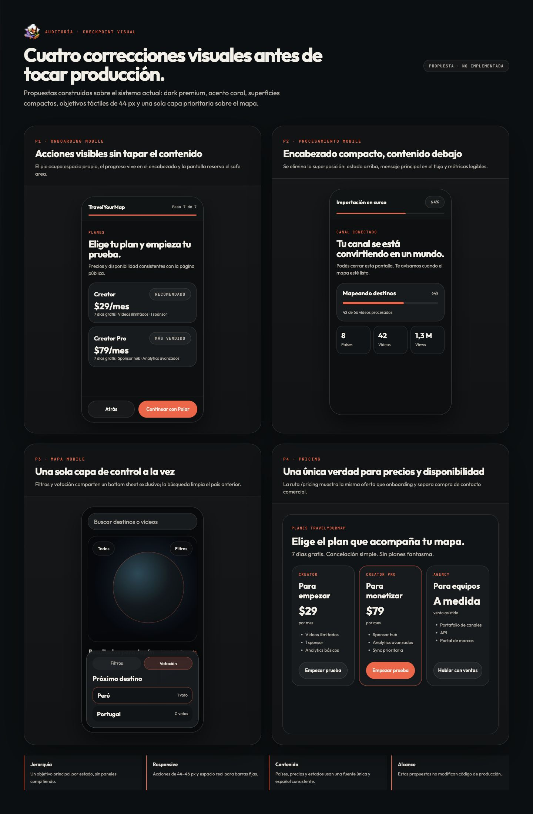

| ID | Componente propuesto | Qué corrige | Decisión sugerida |
|---|---|---|---|
| P1 | Onboarding mobile con pie dentro del layout | Barra fija que tapa cards y métricas | Aprobar arquitectura; ajustar copy final junto con pricing |
| P2 | Procesamiento con encabezado compacto | Título oculto debajo del header | Aprobar; reutilizar el mismo componente de progreso del onboarding |
| P3 | Bottom sheet único para filtros/votación | Paneles apilados y estados incompatibles | Aprobar patrón; definir si buscar limpia o conserva filtros |
| P4 | Pricing real y consistente | Redirección, precios contradictorios y Agency fantasma | Resolver primero la oferta comercial; luego implementar |

Archivo navegable de la propuesta: [`propuesta-visual.html`](propuesta-visual.html).

## Hallazgos críticos

### F01 · `/pricing` no existe como página y redirige al onboarding

- **Severidad:** crítica
- **URL solicitada:** `http://localhost:3000/pricing`
- **URL resultante:** `http://localhost:3000/onboarding?lang=es`
- **Impacto:** el visitante que quiere comparar precios entra a un flujo de creación. También invalida el CTA “Contactar ventas” de Agency y hace que el sitemap publique una URL que redirige.
- **Evidencia de código:** `src/app/pricing/page.tsx:21` redirige siempre al onboarding si no hay `plan`; `src/app/sitemap.ts:16` incluye `/pricing`.
- **Recomendación:** implementar P4 como ruta informativa real. Mantener el checkout bajo CTA explícito y retirar del sitemap cualquier URL que no responda `200`.

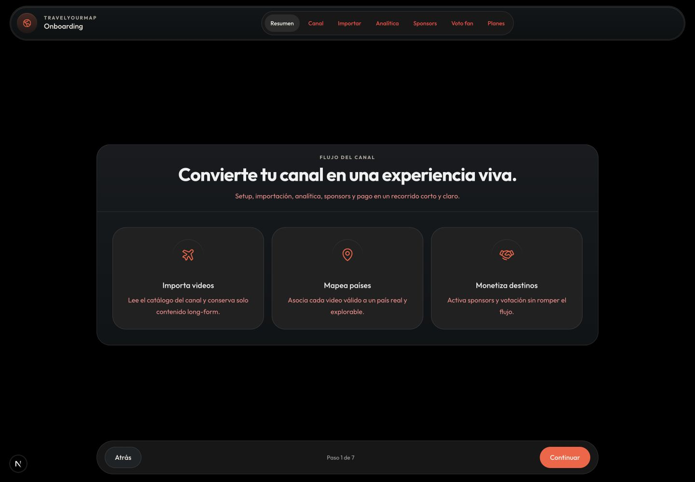

### F02 · El mapa permite capas incompatibles y mezcla el país con la búsqueda

- **Severidad:** crítica
- **URL:** `http://localhost:3000/map`
- **Reproducción:** abrir filtros, abrir “Fan vote”, seleccionar Perú, buscar `japan`.
- **Resultado:** filtros y votación quedan apilados; aparecen videos de Japón bajo el encabezado **“Videos en Perú”** y Perú sigue seleccionado.
- **Impacto:** el usuario no puede saber si ve un país, una búsqueda o la intersección de ambos. La votación tapa resultados y controles.
- **Recomendación:** implementar P3. Un solo bottom sheet visible; modelar `selectedCountry`, `query` y `activeOverlay` como estados explícitos. Al confirmar una búsqueda global, limpiar el país o mostrar una etiqueta inequívoca de intersección.

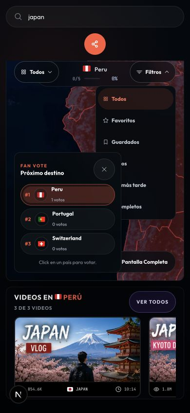

### F03 · Consentimientos aparentan guardarse sin una sesión válida

- **Severidad:** crítica
- **URL:** `http://localhost:3000/auth/consents`
- **Reproducción:** abrir la ruta sin autenticar, esperar la carga y pulsar “Guardar preferencias”.
- **Resultado:** aparece “Preferencias guardadas correctamente”.
- **Impacto:** confirmación falsa o guardado anónimo de una preferencia que debería pertenecer a una cuenta. Es un problema de confianza y de integridad del estado.
- **Recomendación:** proteger la ruta en servidor, devolver a `/auth?next=/auth/consents` si no hay sesión y confirmar solo después de persistencia verificada.

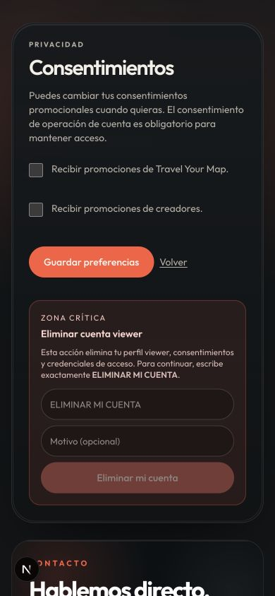

### F04 · Precios y disponibilidad se contradicen

- **Severidad:** crítica
- **URLs:** `/`, `/pricing`, `/onboarding?demo=1` paso 7
- **Resultado:** la landing ofrece Creator Pro a `$79/mes` y Agency a `$199/mes`; onboarding ofrece Creator a `$29`, Pro a `$79` y Agency deshabilitado como “Próximamente”.
- **Impacto:** una persona puede tomar una decisión de compra con información incorrecta; ventas y producto prometen ofertas distintas.
- **Recomendación:** centralizar nombre, precio, periodo, disponibilidad, prueba y CTA en `src/lib/plans.ts`. Landing, pricing, checkout y onboarding deben leer el mismo modelo. P4 ilustra el resultado, pero la oferta comercial debe validarse antes de implementarlo.

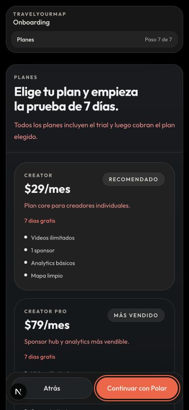

## Hallazgos de severidad alta

### F05 · La barra de acciones del onboarding tapa contenido en mobile

- **URLs:** `/onboarding?demo=1`, pasos 4–7
- **Resultado:** el pie fijo se superpone a la última card, métricas y texto legal.
- **Impacto:** contenido no visible, scroll confuso y riesgo de aceptar una acción sin leer el contexto.
- **Recomendación:** P1. El footer debe ocupar espacio real dentro de un layout `grid` o `flex`; reservar `safe-area-inset-bottom` y comprobar todos los pasos, no solo el primero.

| Paso 4 | Paso 7 |
|---|---|
| 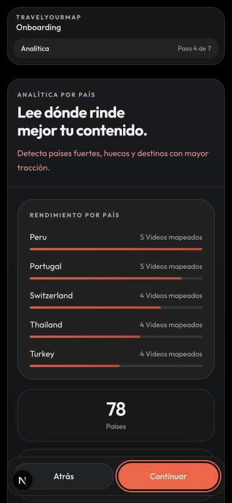 |  |

### F06 · El encabezado de procesamiento oculta el título en mobile

- **URL:** `/onboarding/processing?qa=responsive`
- **Resultado:** la pantalla muestra “convirtiendo en un mundo”; las primeras líneas quedan debajo del header.
- **Impacto:** el mensaje principal pierde contexto justo en un estado de espera sensible.
- **Recomendación:** P2. Encabezado compacto en flujo normal, no superpuesto; progreso y estado pueden compartir una sola franja.

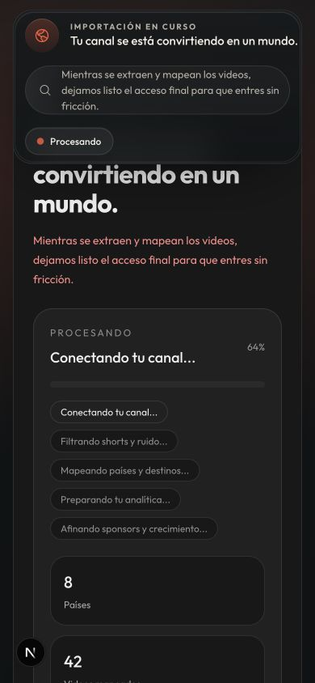

### F07 · “Conectar” parece botón, pero es un `span`

- **URL:** `/onboarding?demo=1`, paso 4
- **Evidencia de código:** `src/components/onboarding/onboarding-flow.tsx:1042` renderiza ``.
- **Impacto:** botón muerto, sin foco, sin evento y sin semántica accesible.
- **Recomendación:** si la integración existe, usar el botón compartido con estado loading/success/error. Si aún no existe, eliminar el CTA o rotularlo “Vista previa”; no mostrar una acción falsa.

### F08 · CTAs principales de la landing llevan a destinos distintos

- **URL:** `/`
- **Resultado:** el CTA del header inicia onboarding; “Crear mi mapa” del hero/card entra a `/map?channelId=demo-channel`.
- **Impacto:** la acción primaria cambia de significado según su ubicación y envía a usuarios reales a un mapa demo.
- **Recomendación:** una única función `getPrimaryCtaHref(locale)` y un CTA secundario explícito “Ver demo”.

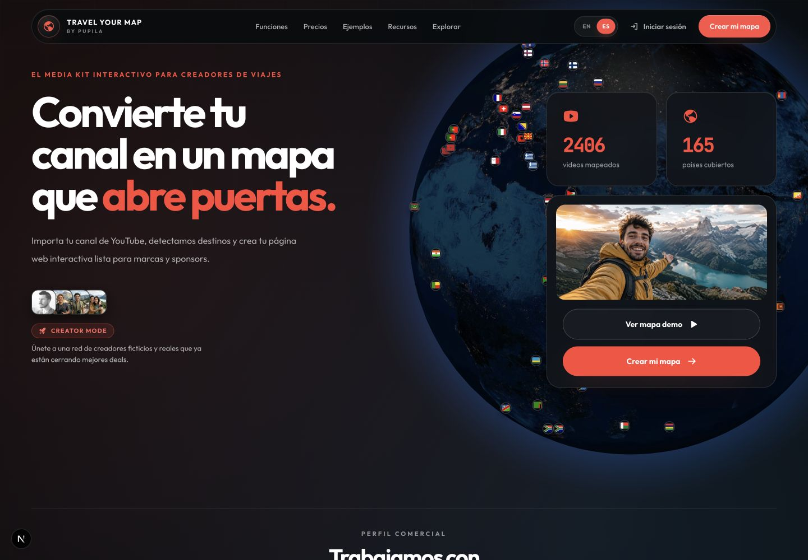

### F09 · Objetivos táctiles inferiores al mínimo del sistema

- **URLs principales:** `/map`, `/admin?qa=responsive`, `/creator-panel?qa=responsive`, `/demo-diseno`
- **Resultado:** marcadores de mapa de `20×20 px`; chips, tabs y filtros de `24–40 px`.
- **Impacto:** baja precisión táctil y riesgo de incumplimiento de accesibilidad motora. `Design.MD` define 44/45 px como mínimo.
- **Recomendación:** ampliar el hit area sin agrandar necesariamente el glyph; mínimo `44×44`, foco visible y separación de 8 px entre acciones adyacentes.

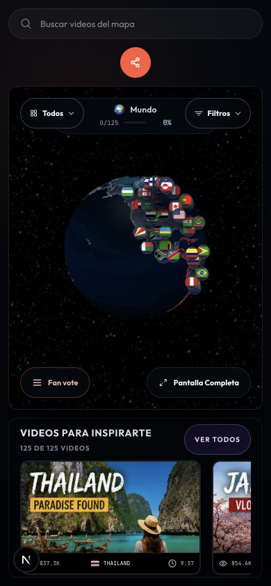

### F10 · La versión inglesa está parcialmente en español

- **URL:** `/?lang=en`
- **Ejemplos:** “Crear mi mapa”, “Cargando mapa…”, filas de Agency, “Contacto”, “Soporte” y textos alternativos en español; el CTA apunta a `?lang=es`.
- **Impacto:** rompe confianza internacional y puede cambiar accidentalmente el locale durante la conversión.
- **Recomendación:** extraer todas las cadenas a un diccionario tipado; no permitir literales de UI en componentes localizados y añadir una prueba de snapshot por locale.

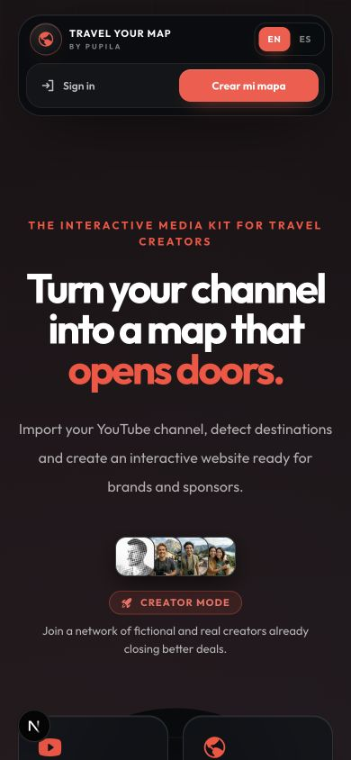

### F11 · El dashboard demo muestra contenido ajeno al producto

- **URL:** `/dashboard`
- **Resultado:** aparecen videos de fitness, cuarentena y documentales bajo Argentina.
- **Impacto:** contradice el posicionamiento de viajes y la promesa de clasificación geográfica; puede confundirse con datos reales del creador.
- **Recomendación:** fixture único y etiquetado “Datos de demostración”; usar contenido de viajes representativo y aislarlo de producción.

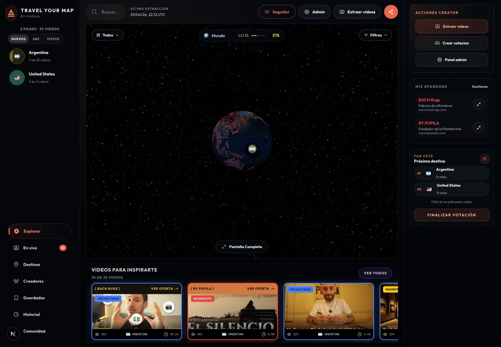

### F12 · Media kit y perfil público cuentan historias incompatibles

- **URLs:** `/u/demo` y `/u/demo/media-kit`
- **Resultado:** el perfil muestra `125 videos / 78 países`; el media kit muestra `0 videos / 0 países / 0 views`. El meta description también declara cero y el canonical apunta a otro username.
- **Impacto:** destruye credibilidad ante marcas y afecta cómo se comparte/indexa el documento.
- **Recomendación:** ambos deben leer el mismo agregado de canal. No publicar media kit si la carga falla; mostrar error recuperable, nunca ceros plausibles.

| Perfil | Media kit |
|---|---|
| 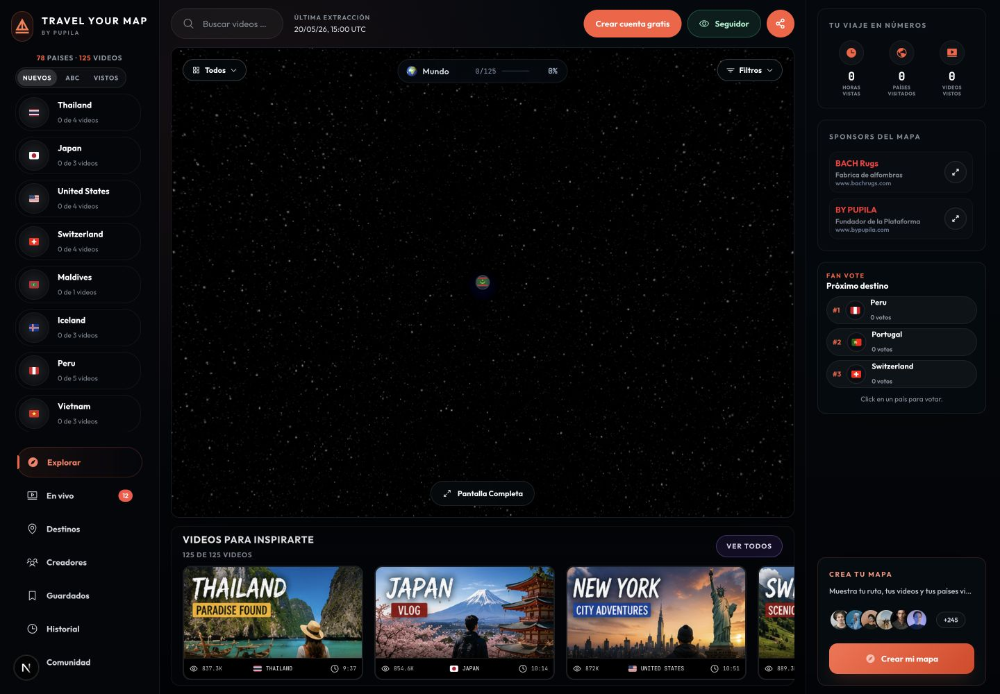 | 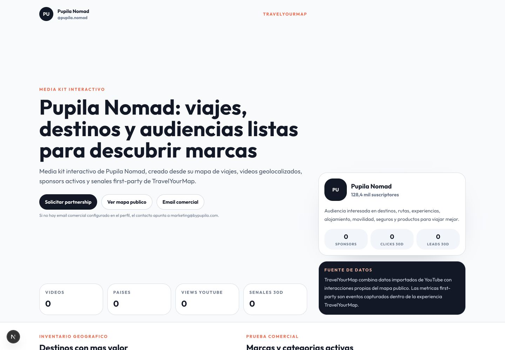 |

## Hallazgos de severidad media

### F13 · Enlaces visibles con `href="#"` y botones sin nombre

- **URL:** `/demo-diseno`
- **Resultado:** “Ver opciones”, “Explorar” y “Reclamar beneficio” navegan a `#`; el barrido detectó 12 botones sin nombre accesible.
- **Impacto:** acciones muertas, salto al inicio y mala experiencia con lector de pantalla.
- **Recomendación:** conectar destinos reales o retirar los controles; añadir `aria-label` solo cuando no exista texto visible equivalente.

### F14 · Español e inglés se mezclan dentro de la UI española

- **URLs:** `/explore`, `/onboarding`, `/map`, `/creator-panel`
- **Ejemplos:** `Search across videos, countries, or creators`, `DISCOVERY EDITORIAL`, `Brand deals`, `Placements`, `long-form`, `loader`, `Views`; países como `Japan`, `Mexico`, `Italy`.
- **Impacto:** producto percibido como incompleto y taxonomías difíciles de mantener.
- **Recomendación:** reutilizar un formateador de países con `Intl.DisplayNames` y centralizar copy de dominio.

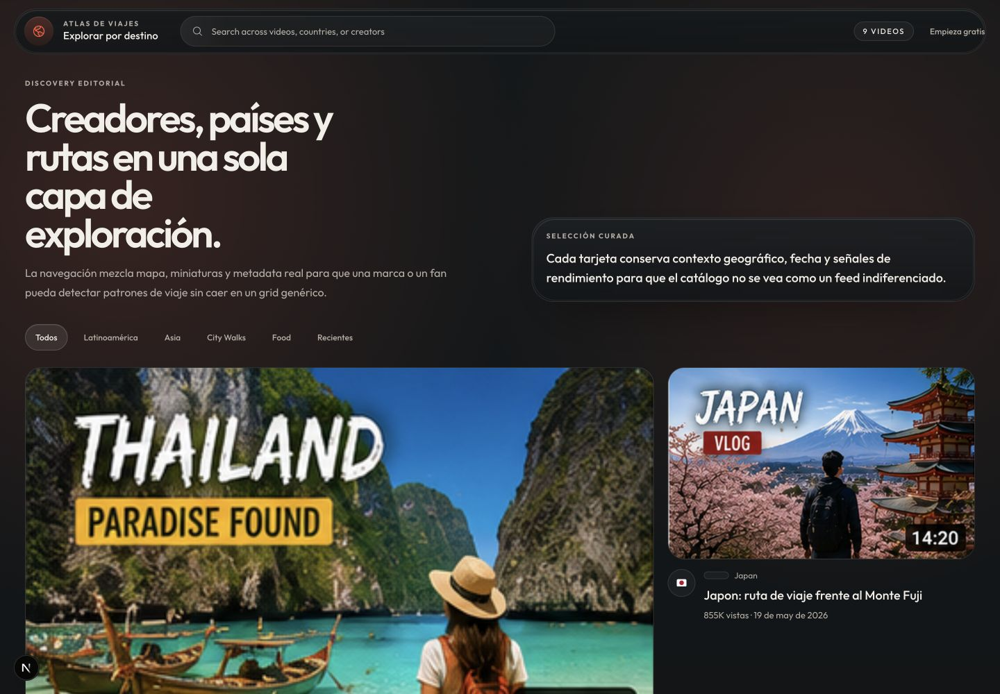

### F15 · Errores de redacción, concordancia y tildes

- **Ejemplos:** “Importa tu canal…, detectamos destinos y crea tu página”; “Muestras tus sponsors”; “Genera mas”; “7 dias gratis”; “1 votos”; “Peru/Japon”; “codigo/invalido”.
- **Impacto:** resta confianza en compra, autenticación y portal de marcas.
- **Recomendación:** revisión editorial previa a release y test de contenido para cadenas críticas. Usar singular/plural con `Intl.PluralRules`.

### F16 · Roles de contacto inconsistentes

- **URLs:** `/` y `/brand-portal/responsive-qa-access`
- **Resultado:** Marketing describe problemas de plataforma; Soporte describe preguntas generales. Auth, en cambio, atribuye a soporte el acceso técnico.
- **Impacto:** usuarios escriben al canal equivocado y se diluye la función de cada dirección.
- **Recomendación:** definir una matriz única: ventas/marketing, soporte técnico y privacidad/legal; reutilizarla en todos los puntos de contacto.

### F17 · Navegación por ancla queda debajo del header sticky

- **URL:** `/#funciones`
- **Resultado:** al pulsar “Funciones”, el encabezado tapa la parte superior de la sección y deja texto anterior cortado.
- **Recomendación:** `scroll-margin-top` en destinos o una variable compartida con la altura real del header.

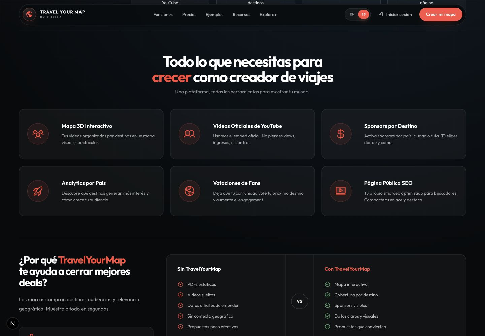

### F18 · SEO: H1, canonical y sitemap incompletos

- `/map` y `/u/demo` no exponen H1.
- Landing, mapa y explore no declaran canonical en el DOM auditado.
- `/pricing` está en sitemap aunque redirige.
- `/u/demo` canonicaliza a `/u/pupila.nomad`; el media kit también usa otro username.
- Varias rutas internas heredan metadata global genérica.
- **Recomendación:** matriz de metadata por tipo de ruta; sitemap solo con páginas `200` indexables; canonical consistente con el recurso real; un H1 semántico, aunque visualmente compacto.

### F19 · Prototipos y QA son accesibles por URL pública

- **URLs:** `/country-card-proposals`, `/map-proposal`, `/map-proposal-v1`, `/map-proposal-2`, `/map-admin-proposal`, `/demo-diseno`.
- **Resultado:** exponen copy de QA, controles no terminados y branding alternativo.
- **Impacto:** aunque `robots.txt` los bloquee, siguen siendo compartibles y un `Disallow` no equivale a control de acceso.
- **Recomendación:** compilar estas rutas solo en desarrollo, protegerlas con sesión/feature flag o responder 404 fuera de entornos internos. Mantener `noindex` explícito como segunda barrera.

### F20 · Uso de marca YouTube fuera del player oficial

- **URLs/código:** landing y `/map-proposal-v1`; `YoutubeLogo` aparece en métricas y pasos.
- **Impacto:** `Design.MD` prohíbe el logo de YouTube fuera del iframe oficial. Además, propuestas internas usan la marca “ROAM”, inconsistente con TravelYourMap.
- **Recomendación:** sustituir por iconos genéricos de video/play ya disponibles; conservar la marca solo dentro del reproductor oficial.

### F21 · Carga de consentimientos sin estructura ni recuperación

- **URL:** `/auth/consents`
- **Resultado:** durante varios segundos solo se muestra “Cargando…”. Luego la UI aparece; no es un bloqueo permanente.
- **Impacto:** parece una pantalla rota y no explica si se valida sesión o se cargan preferencias.
- **Recomendación:** skeleton que conserve estructura, mensaje de estado accesible y timeout con reintento o redirección.

### F22 · Selects sin nombre accesible en Creator Panel

- **URL:** `/creator-panel?qa=responsive`
- **Resultado:** dos `combobox` no tienen label accesible en el DOM.
- **Impacto:** lector de pantalla anuncia controles sin propósito.
- **Recomendación:** asociar `<label>` persistente; el placeholder no reemplaza una etiqueta.

## Hallazgos de severidad baja

### F23 · 404 contiene un texto redundante

- **URL:** cualquier ruta inexistente, por ejemplo `/esta-ruta-no-existe`
- **Resultado:** la recuperación funciona y ofrece rutas útiles; “Soporte / support” parece copy provisional bilingüe.
- **Recomendación:** dejar un único término localizado.

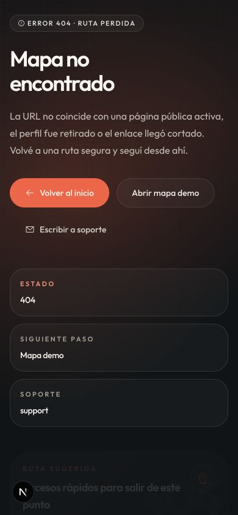

### F24 · Duplicación y deuda menor de implementación

- **Ejemplo:** planes y copy se declaran en más de un lugar; el componente de pricing contiene lógica propia mientras existe `src/lib/plans.ts`.
- **Impacto:** explica parte de las contradicciones observadas y aumenta el costo de corregir contenido.
- **Recomendación:** una fuente tipada por dominio, adaptadores de presentación por pantalla y tests de consistencia entre landing/onboarding/checkout.

## Inventario de rutas revisadas

| # | URL/estado | Salud general | Evidencia |
|---:|---|---|---|
| 1 | `/` ES | Funciona; CTAs inconsistentes, copy y ancla a corregir | [desktop](screenshots/d-landing.png) · [mobile](screenshots/m-landing.png) |
| 2 | `/pricing` | Crítica: redirige a onboarding | [desktop](screenshots/d-pricing.png) · [mobile](screenshots/m-pricing.png) |
| 3 | `/onboarding?demo=1` | Flujo completo funcional; solapamientos, copy y CTA muerto | [desktop](screenshots/d-onboarding.png) · [mobile](screenshots/m-onboarding.png) |
| 4 | `/onboarding/processing?qa=responsive` | Funciona; H1 oculto en mobile | [desktop](screenshots/d-onboarding-processing.png) · [mobile](screenshots/m-onboarding-processing.png) |
| 5 | `/auth` | Validación y error de credenciales funcionan | [desktop](screenshots/d-auth.png) · [error](screenshots/i-auth-invalid-mobile.png) |
| 6 | `/auth/viewer-register` | Responsive; sin bloqueo funcional observado | [desktop](screenshots/d-viewer-register.png) · [mobile](screenshots/m-viewer-register.png) |
| 7 | `/auth/consents` | Crítica: accesible/guardable sin sesión; carga débil | [desktop](screenshots/d-consents.png) · [mobile](screenshots/m-consents.png) |
| 8 | `/map` | Carga y video funcionan; estados de búsqueda/paneles fallan | [desktop estable](screenshots/d-map-stable.png) · [video](screenshots/i-map-video-dialog-mobile.png) |
| 9 | `/explore` | Funciona; mezcla idiomas y metadata incompleta | [desktop](screenshots/d-explore.png) · [mobile](screenshots/m-explore.png) |
| 10 | `/u/demo` | Renderiza; sin H1 y canonical/usuario inconsistente | [desktop](screenshots/d-profile-demo.png) · [mobile](screenshots/m-profile-demo.png) |
| 11 | `/u/demo/media-kit` | Renderiza; métricas y canonical erróneos | [desktop](screenshots/d-media-kit.png) · [mobile](screenshots/m-media-kit.png) |
| 12 | `/dashboard` | Responsive; contenido demo no relacionado | [desktop](screenshots/d-dashboard.png) · [mobile](screenshots/m-dashboard.png) |
| 13 | `/creator-panel?qa=responsive` | Menú, tabs y modal funcionan; labels/copy a corregir | [desktop](screenshots/d-creator-panel.png) · [mobile](screenshots/m-creator-panel.png) |
| 14 | `/admin?qa=responsive` | Responsive; filtros con targets pequeños | [desktop](screenshots/d-admin.png) · [mobile](screenshots/m-admin.png) |
| 15 | `/brand-portal/responsive-qa-access` | Error inválido funciona; copy y rol de contacto | [desktop](screenshots/d-brand-portal.png) · [mobile](screenshots/m-brand-portal.png) |
| 16 | `/sponsor-report/responsive-qa` | Responsive; sin bloqueo principal observado | [desktop](screenshots/d-sponsor-report.png) · [mobile](screenshots/m-sponsor-report.png) |
| 17 | `/status` | Renderiza; metadata global poco específica | [desktop](screenshots/d-status.png) · [mobile](screenshots/m-status.png) |
| 18 | `/privacy` | Estable y responsive | [desktop](screenshots/d-privacy.png) · [mobile](screenshots/m-privacy.png) |
| 19 | `/terms` | Estable tras carga de fuente; responsive | [desktop estable](screenshots/d-terms-stable.png) · [mobile](screenshots/m-terms.png) |
| 20 | `/country-card-proposals` | Prototipo accesible; no debería exponerse | [desktop](screenshots/d-country-card-proposals.png) · [mobile](screenshots/m-country-card-proposals.png) |
| 21 | `/map-proposal` | Prototipo accesible; branding/QA | [desktop](screenshots/d-map-proposal.png) · [mobile](screenshots/m-map-proposal.png) |
| 22 | `/map-proposal-v1` | Prototipo accesible; marca YouTube/ROAM | [desktop](screenshots/d-map-proposal-v1.png) · [mobile](screenshots/m-map-proposal-v1.png) |
| 23 | `/map-proposal-2` | Carga diferida; estable después de esperar | [desktop](screenshots/d-map-proposal-2.png) · [mobile estable](screenshots/m-map-proposal-2-stable.png) |
| 24 | `/map-admin-proposal?qa=responsive` | Prototipo accesible; QA interna | [desktop](screenshots/d-map-admin-proposal.png) · [mobile](screenshots/m-map-admin-proposal.png) |
| 25 | `/demo-diseno` | Enlaces muertos y botones sin nombre | [desktop](screenshots/d-demo-diseno.png) · [mobile](screenshots/m-demo-diseno.png) |
| 26 | `/?lang=en` | Funciona; localización incompleta | [mobile](screenshots/m-landing-en.png) |
| 27 | `/esta-ruta-no-existe` | Recuperación correcta; copy menor | [mobile](screenshots/m-not-found.png) |

## Validación técnica y responsive

- `npm run lint`: aprobado.
- `npx tsc --noEmit --incremental false`: aprobado.
- No se detectaron imágenes rotas en el barrido de rutas.
- No se detectó overflow horizontal a nivel documento en las rutas públicas mobile. Los overflows observados pertenecen principalmente a carousels/tablas internos.
- Los mapas WebGL y algunas propuestas necesitan entre 1,8 y 2,5 segundos antes de quedar estables; las capturas tomadas durante carga fueron descartadas y se conservaron las versiones estables.
- Auth rechazó credenciales inválidas correctamente. Brand Portal también mostró error ante acceso inválido.
- Los siete pasos del onboarding se pudieron recorrer. El consentimiento legal impide continuar sin marcar la casilla, aunque sería más claro deshabilitar el CTA hasta entonces.
- Filtros, votación y dialog de video funcionan por separado; el fallo aparece al combinarlos.

Datos de apoyo: [`desktop-metrics.json`](desktop-metrics.json) y [`mobile-metrics.json`](mobile-metrics.json).

## Límites de esta auditoría

- Se ejecutó en local con datos demo/QA; no valida paridad total con producción ni analítica real.
- No se realizó compra real ni checkout externo para evitar efectos financieros.
- No se usaron cuentas reales de creador, viewer, admin o sponsor; las rutas QA disponibles se usaron para cobertura.
- No es una certificación WCAG: se revisaron semántica visible, nombres accesibles y tamaños táctiles, pero no una matriz completa de lectores de pantalla/navegadores.
- La auditoría no modifica la plataforma. Las propuestas P1–P4 requieren aprobación o refinamiento antes de implementación.

## Orden de resolución recomendado

1. **Oferta y conversión:** F01, F04, F08 y P4.
2. **Estado y confianza:** F02, F03 y P3.
3. **Responsive crítico:** F05, F06, F09 y P1–P2.
4. **Datos públicos:** F11 y F12.
5. **Accesibilidad y contenido:** F07, F10, F13–F17, F21–F22.
6. **SEO, marca y endurecimiento:** F18–F20, F23–F24.
